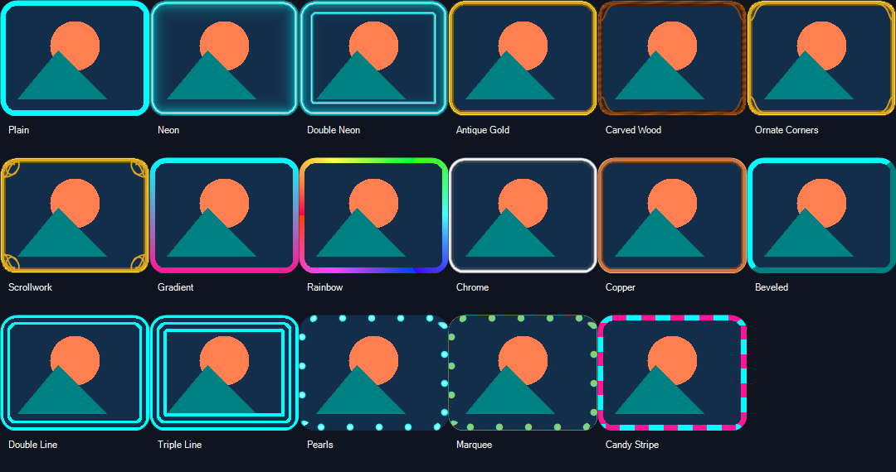
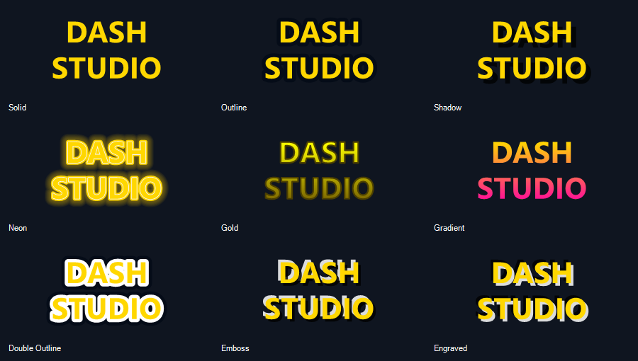

# DashCanvas Studio

**Turn your pictures into a Geometry Dash texture pack.**

A visual Windows editor by **abdulazizmhammed**. Customize game artwork, build layered designs, and preview every change before you apply it.

Choose a game asset, add your own picture, style its frame and text, and preview the result before applying or exporting a texture pack. The interface is in English. Image processing stays on your PC and needs no cloud account or API key.



## Download and start

**[Download DashCanvas Studio 3 for Windows](downloads/DashCanvas-Portable.zip?raw=true)**

1. Extract the ZIP into a folder you can write to, then open `DashCanvas.exe`.
2. Choose your Geometry Dash installation, select an asset, and add your picture or use the current texture.
3. Adjust frames, text and layers. Close the game, then choose **Apply selected**, or export your design as a texture-pack ZIP.

Keep the app in its extracted folder so its preferences and recovery backups stay together. See [download information and SHA-256](downloads/README.md).
## Features

- Searchable asset catalogue: backgrounds, menu buttons, logos, difficulty faces, player-icon layers, bitmap fonts and more. The catalogue depends on the installed game version.
- 17 frame styles, including neon, vintage ornaments, gradient, rainbow, chrome, copper, pearls and multiple borders.
- Solid, dashed, dotted and dash-dot lines with adjustable spacing, color, width and glow.
- Frames follow the actual picture edge and transparency, including custom silhouettes and holes.
- 9 text effects, multiline labels, alignment, line spacing, underline, strikethrough and custom outline styling.
- Installed Windows fonts and whole bitmap-font styling while retaining the game's character metrics.
- Separate image, symbol, text and frame layers with ordering, deletion/restoration and opacity.
- A dedicated Geode Texture Loader pack, selective restore, ZIP export and transactional backups.



## Run and build

Use Windows with the 64-bit .NET Framework compiler and Windows Forms available. Windows 10/11 are the intended environments. The build script uses the compiler at `%WINDIR%\Microsoft.NET\Framework64\v4.0.30319\csc.exe`; no NuGet packages or network downloads are required.

```powershell
powershell -File .\Build.ps1
.\DashCanvas.exe
```

Automatic application requires a local Geometry Dash installation and [Geode Texture Loader](https://github.com/geode-sdk/textureldr). ZIP export is available without automatic application. Close the game before Apply or Restore.

## Tests and packaging

```powershell
powershell -File .\Test.ps1
powershell -File .\Package.ps1
```

`Test.ps1` runs synthetic rendering tests without a game installation and writes results to `test-results/`. `Package.ps1` creates a portable ZIP in `dist/` from an explicit list of application files, excluding personal preferences, backups, game resources and test outputs.

See [the user guide](docs/USER_GUIDE.md), [changelog](CHANGELOG.md) and [contributing guide](CONTRIBUTING.md).

## Limits

The editor changes textures, not game logic or control positions. Existing game artwork is one image layer; it cannot be automatically separated into its original layers. Applied/exported textures are flattened. Editable layer settings are retained for the current selected draft, not saved as a project for reopening. Game tint, animation, scale and existing font metrics can affect the final appearance. Live gameplay needs to be verified on the user's installation.

## License and attribution

Copyright (c) 2026 **abdulazizmhammed**. Distributed under the [MIT License](LICENSE), using the [OSI MIT text](https://opensource.org/license/mit).

The license covers this program's code and documentation, not Geometry Dash artwork or third-party texture packs. See [third-party notices](THIRD_PARTY_NOTICES.md). This is an independent project and is not affiliated with or endorsed by RobTop Games.
